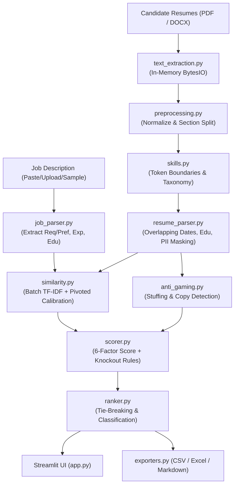

# AI-Based Resume Screening & Candidate Shortlisting System

[](https://www.python.org/downloads/)
[](https://streamlit.io/)
[](https://opensource.org/licenses/MIT)
[](https://pytest.org)

An explainable, production-ready AI/ML system designed to assist human recruiters in evaluating and ranking resumes against Job Descriptions (JDs). Built with **Python 3.11+**, **Streamlit**, and **Scikit-Learn**, it addresses high-volume hiring bottlenecks through transparent multi-factor scoring, anti-gaming protection, and privacy-preserving in-memory processing.

---

## 🌟 Key Features

1. **Multi-Format In-Memory Ingestion:**
   - Evaluates **PDF**, **DOCX**, and **TXT** resumes simultaneously.
   - 100% in-memory processing (`io.BytesIO`); resumes are never saved to disk.
   - Robust defenses against corrupt, empty, password-encrypted, or oversized files with graceful warnings.

2. **Precision Token & Symbol Boundary Matching:**
   - 220+ canonical skills across 8 categories with rich alias resolution.
   - Symbol-safe lookarounds (`(?<![a-zA-Z0-9_+#])TOKEN(?![a-zA-Z0-9_+#])`) accurately parse `C++`, `C#`, `.NET`, `Node.js`, and `CI/CD`.
   - Guaranteed sub-token protection (e.g. `java` never matches inside `javascript`).
   - Guarded fuzzy matching (`rapidfuzz`) for typos without corrupting short acronyms.

3. **Multi-Factor Explainable Scoring (0–100):**
   - Weighted composition: Required Skills (40%), Preferred Skills (10%), Content Similarity (20%), Experience Fit (15%), Education Fit (10%), Evidence Quality (5%).
   - Hard 30% knockout rule on required qualifications.
   - Natural language justifications generated for every candidate.

4. **Length-Fair Calibrated TF-IDF:**
   - Batch corpus fitting (JD + batch resumes + reference corpus) ensures meaningful IDF.
   - Blended query coverage neutralizes length bias, preventing long CVs from being penalized.
   - Monotonic sigmoid calibration ($x_0 = 0.15, k = 22.0$) maps raw sparse cosine into realistic recruiter percentages.

5. **Anti-Gaming & Keyword Stuffing Protection:**
   - Flags excessive single-skill repetition (> 8 occurrences).
   - Detects abnormal keyword density (> 35% of total tokens).
   - Identifies verbatim copy-paste JD text and applies transparent penalty deductions.

6. **Interactive Recruiter Dashboard:**
   - 5 tabs: Job Description (with editable requirements), Resume Upload, Results & Rankings, Side-by-Side Radar Comparison, and Methodology.
   - Dynamic real-time re-scoring via sidebar sliders without re-uploading files.
   - Export rankings to CSV, styled Excel (`.xlsx`), and individual candidate Markdown reports.

---

## 🏛️ System Architecture



---

## 🚀 Quick Start

### 1. Clone & Set Up Environment
```bash
git clone https://github.com/your-username/resume-screening.git
cd resume-screening

# Create and activate Python 3.11 virtual environment
python3.11 -m venv .venv
source .venv/bin/activate

# Install pinned dependencies
pip install -r requirements.txt
```

### 2. Launch Streamlit Web UI
```bash
streamlit run app.py
```
Open your browser at `http://localhost:8501`.

### 3. One-Click Demonstration
1. Navigate to **Tab 1 (Job Description)** and select `python_backend_engineer.txt` from the sample dropdown. Click **Parse & Analyze Job Requirements**.
2. Navigate to **Tab 2 (Upload Resumes)** and click **📁 Load 13 Sample Resumes**.
3. Navigate to **Tab 3 (Results & Ranking)** to inspect the rankings, score distributions, and candidate skill chips!
4. Navigate to **Tab 4 (Candidate Comparison)** to compare top candidates on the interactive 6-axis radar chart.

---

## ⚖️ Scoring Formula & Calibration

The final score $F \in [0, 100]$ is computed as:
$$F = \sum_{i=1}^{6} (w_i \times S_i) - P_{\text{gaming}}$$

Where:
- $S_1$ (Required Skills, 40%): $\frac{\text{Matched Required}}{\text{Total Required}} \times 100$
- $S_2$ (Preferred Skills, 10%): $\frac{\text{Matched Preferred}}{\text{Total Preferred}} \times 100$
- $S_3$ (Similarity, 20%): Sigmoid-calibrated blended TF-IDF cosine & query coverage.
- $S_4$ (Experience, 15%): Candidate years vs required years (overlapping intervals merged; internships at 50%).
- $S_5$ (Education, 10%): Degree hierarchy match (PhD > Master > Bachelor > Diploma).
- $S_6$ (Evidence Quality, 5%): Proportion of matched skills demonstrated in work experience vs only listed.

**Knockout Rule:** If a candidate matches $< 30\%$ of required skills, their score is capped at `49.0` (Rejected band).

---

## 🧪 Running Tests & Evaluation

### Run Test Suite with Code Coverage
```bash
# Run all 46 unit, parser, and end-to-end tests
pytest
```
*Current test suite achieves **91% coverage** across `src/` modules.*

### Run Benchmark Evaluation Script
```bash
python scripts/evaluate.py
```
Evaluates the 13 sample candidate profiles across the 3 benchmark job roles and outputs Precision@k, Recall, F1, and Spearman correlation metrics to `docs/evaluation_results.md`.

---

## 📈 Improvements Over Baseline (Changelog)

| Feature | Basic TF-IDF / Keyword Baseline | Our Production System |
| :--- | :--- | :--- |
| **Token Boundaries** | Naive `\b` fails on `C++`, `C#`, `.NET`, `CI/CD` | Symbol-safe lookaround patterns (`(?<![\w+#.])...(?![\w+#.])`) |
| **Substring False Positives** | `java` matches inside `javascript` | Exact boundary lookaheads prevent sub-token matches |
| **Document Length Bias** | Long, highly-detailed resumes are severely penalized | Pivoted query coverage blends with normalized cosine |
| **Experience Extraction** | Simple regex matches total numbers blindly | Merges overlapping date intervals; scales internships |
| **Adversarial Stuffing** | Keyword stuffers easily game top rank | Repetition & density heuristics flag & penalize stuffers |
| **Explainability** | Single opaque similarity score (0.28) | 6-component breakdown with natural language explanations |
| **Data Privacy** | Files written to `/tmp` disk storage | 100% in-memory processing with automatic PII masking |

---

## ☁️ Deployment on Streamlit Community Cloud

1. Push this repository to GitHub.
2. Visit [share.streamlit.io](https://share.streamlit.io/) and log in with GitHub.
3. Select this repository and set the main file path to `app.py`.
4. The deployment will automatically detect `requirements.txt` and boot the web application.

---

## 📄 License
This project is open-source and licensed under the [MIT License](LICENSE).
# AI-Based-Resume-Screening---Candidate-Shortlisting-System
