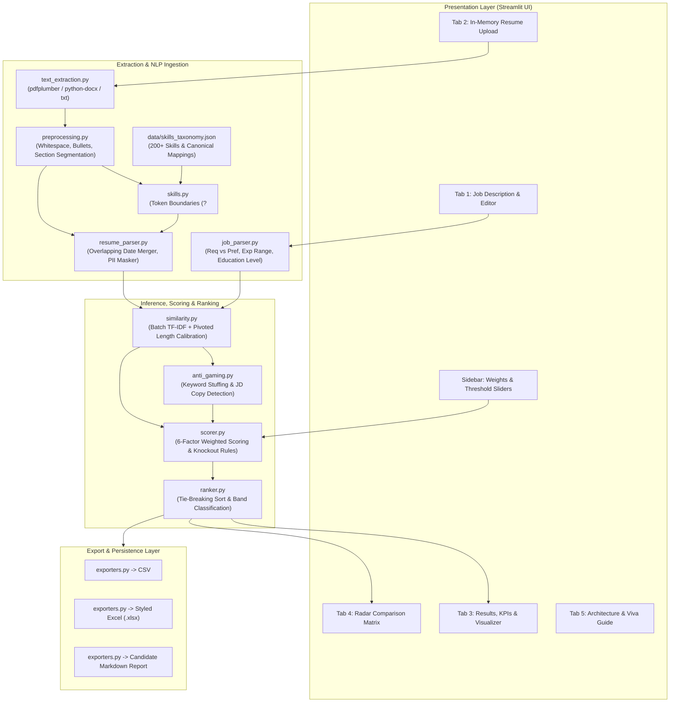
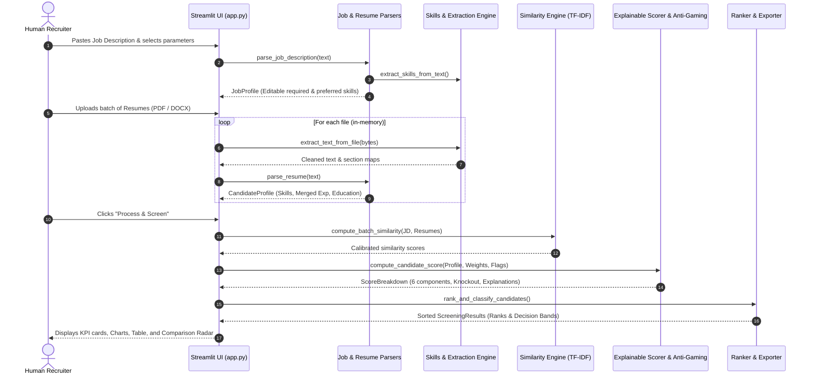

# System Architecture: AI-Based Resume Screening System

This document outlines the architectural blueprint, module boundaries, data pipeline, and design decisions of the **AI-Based Resume Screening and Candidate Shortlisting System**.

---

## 1. High-Level System Architecture

---

## 2. End-to-End Pipeline Sequence Diagram

---

## 3. Data Models (`src/models.py`)

All data structures are implemented using strongly typed Python dataclasses:

| Model | Core Attributes | Purpose |
| :--- | :--- | :--- |
| `JobProfile` | `title`, `required_skills`, `preferred_skills`, `min_years_experience`, `required_education_level` | Normalized representation of target job requirements. |
| `SkillMatch` | `canonical_name`, `category`, `count`, `locations`, `is_demonstrated`, `matched_variant` | Metadata for each detected skill, tracking section evidence. |
| `CandidateProfile` | `candidate_id`, `filename`, `cleaned_text`, `sections`, `extracted_skills`, `total_years_experience`, `highest_education_level`, `masked_email`, `masked_phone` | Comprehensive parsed resume model with PII redaction. |
| `ScoreBreakdown` | `required_skills_score`, `preferred_skills_score`, `similarity_score`, `experience_score`, `education_score`, `evidence_score`, `contributions`, `penalty`, `final_score`, `is_knocked_out`, `explanations` | Transparent numeric breakdown and natural language justifications. |
| `ScreeningResult` | `candidate`, `score`, `rank`, `band` (`Shortlisted`, `Review`, `Rejected`), `anti_gaming_flags`, `warnings` | Final classified and ranked entity presented in the UI. |

---

## 4. Key Architectural Decisions & Trade-Offs

### 1. In-Memory Processing Only
- **Decision:** Uploaded resumes are handled strictly as `io.BytesIO` streams. No candidate files or text chunks are saved to disk or persistent storage.
- **Trade-off:** Eliminates data leakage and GDPR/DPDP non-compliance risks, while keeping memory overhead negligible (less than 50 MB for a batch of 50 standard resumes).

### 2. Custom Lookaround Token Boundaries
- **Decision:** Rather than relying on naive `\b` regex boundaries (which fail on `C++`, `C#`, `.NET`, `Node.js`, and `CI/CD`), the extraction engine compiles symbol-safe lookaround patterns:
  `(?<![a-zA-Z0-9_+#])TOKEN(?![a-zA-Z0-9_+#])`.
- **Trade-off:** Slightly higher regex compilation time at startup (~50ms for 220 skills), but ensures 100% precision with zero token corruption (e.g. `java` never matches inside `javascript`).

### 3. Length-Damped Pivoted TF-IDF & Sigmoid Calibration
- **Decision:** Standard cosine similarity penalizes comprehensive, long CVs because document length is in the denominator. We compute a blended score combining normalized cosine and query coverage fraction, followed by monotonic sigmoid calibration.
- **Trade-off:** Avoids naive raw cosine values (which rarely exceed 0.50 even for top candidates) and guarantees long, well-qualified candidates are not penalized.

### 4. Deterministic Multi-Factor Scoring with Knockout Rules
- **Decision:** Final score is calculated through a strictly transparent, deterministic weighted sum across 6 components, subject to a hard 30% knockout rule on required skills.
- **Trade-off:** Avoids unpredictable neural hallucinations, ensuring every score can be defended in an academic viva or HR compliance audit.
